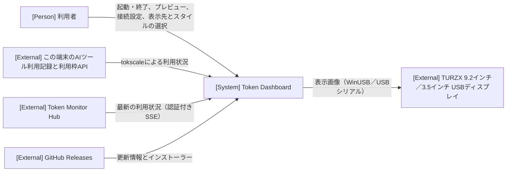

# アーキテクチャ

全体構造、共通方針、設計上の制約の正本です。具体的な処理は実現パターンの設計、保存形式は [データ設計](design/data.md)、仕様は [ユースケース一覧](project.md#usecases) から参照します。

## 1. システムコンテキスト

## 2. コンテナ

| コンテナ | 技術 | 責務 | リポジトリ内パス |
| --- | --- | --- | --- |
| 常駐アプリ本体 | Go・Wails v3、同梱した tokscale | タスクトレイ常駐、選択した取得元からの取得、描画要求と結果の確定、TURZX への送信、設定の保存、新版の確認・取得・検証 | `main.go`、`internal/` |
| ウィンドウと画像生成処理 | React・TypeScript（WebView2）、Handlebars・HTML/CSS・Canvas | 非表示中も動く画像生成処理、確定した表示画像のプレビュー、接続設定の入力、更新の適用操作 | `frontend/`、`themes/` |
| 更新インストーラー | NSIS | アプリ本体の終了後にファイルと登録情報（サインイン時の自動起動を含む）を更新し、アプリを再起動する | `build/windows/nsis/` |

状態の所有者は常駐アプリ本体です。取得した全体とサービス別の利用状況は本体のメモリにだけ持ち、保存しません。保存形式は [データ設計](design/data.md) に記します。本体が対象ページを確定して1枚を要求し、WebView2内のCanvasで描きます。本体は同じ描画から得たプレビュー用PNGと機器用画像を検証して出力します。プレビュー区画は確定したPNGを表示し、独自には描画しません。ウィンドウを閉じても本体と画像生成処理はタスクトレイで動き続けます。

依存方向は、ウィンドウ画面から本体の Wails サービスへの呼び出しと、本体からウィンドウ画面へのイベント通知だけです。関係線ごとのモック切り替え境界は次のとおりです。

- **Hub と本体の間**: モックの合成点は置きません。検証時は、接続設定の URL を制御可能な SSE サーバーへ向けます。
- **本体と TURZX の間**: モックの合成点は置きません。自動検証は機器を接続しない状態で行い、表示内容はプレビューで確認します。TURZX への実表示は実機で確認します。
- **本体と GitHub Releases の間**: 段階2・3のモックに限り、モックでの起動のときだけ、更新元を本体が作る署名付きの固定の新版（ローカルのフォルダー）へ向け、インストーラーの起動を何もしない処理に置き換えます。確認・取得・検証・適用前の再検証と終了は本番の処理を使います。
- **本体の最新状態**: Hub受信またはローカル取得の実処理が最新状態を置き換えます。設定と利用状況を固定値へ切り替える合成点は置かず、取得失敗から固定値へ切り替えません。

## 3. 実現パターン

各パターンの設計は、適用するユースケースに着手したときに `design/UCP-n.md` として作成します。

| 実現パターンの設計 | 適用条件・関与コンテナ |
| --- | --- |
| [UCP-1. 受信した最新状態を表示画像にして出力する](design/UCP-1.md) | 外部から受けた状態をメモリ上の最新状態へ反映し、1枚の表示画像を生成して TURZX とプレビューへ出力する（「利用状況をUSBディスプレイに表示する」「Style一覧を閲覧する」「Styleを追加する」「USBディスプレイの焼き付きを防ぐ」）。常駐アプリ本体、ウィンドウ画面、外部の Hub と TURZX |
| [UCP-2. 入力した設定を検証・保存し、実行中の処理へ反映する](design/UCP-2.md) | 画面で入力した設定を本体で検証して保存し、依存する処理へ反映する（「利用状況の取得元と表示先を設定する」「利用状況をUSBディスプレイに表示する」「Styleを追加する」「Styleを削除する」）。常駐アプリ本体、ウィンドウ画面 |
| [UCP-3. 検証・引き渡し・外部プロセスによる確定](design/UCP-3.md) | 検証済みの更新を外部プロセスへ引き渡し、アプリの終了後に確定する（「新版を確認してアプリを更新する」）。常駐アプリ本体、ウィンドウ画面、更新インストーラー、外部の GitHub Releases |

## 4. 設計上の制約

- 選択した取得元からの取得、TURZX への送信、新版の確認は、それぞれ独立した goroutine で動かします。どれかの失敗や待機が、他の処理とタスクトレイ・ウィンドウの応答を止めないようにします。取得元を保存したら従前の取得処理を止め、選択した取得元だけを起動します。
- TURZX への送信は1台に限り、逐次で行います。送信中に次の表示画像ができた場合は、最新の1枚だけを残して前の画像を捨てます。送信中に切断された画像は再送せず、再接続後に最新の画像を送ります。
- 画像の寸法と表示データの構成は、下記の[スタイルの契約](#style-contract)で決めます。描画は既存のHandlebars、HTML/CSS、Canvas経路に統一し、機種別のGo描画器を追加しません。本体がページ構成と表示値を決め、テーマファイルが配置を定義します。
- 9.2インチへは時計回りに90度回転したBaseline JPEG（品質85）を、再圧縮せずに送ります。3.5インチへはCanvasの機器用画像をRGB565へ変換して送り、Goで画面要素を描き直しません。プレビューは正立したPNGとし、180度反転と位置シフトは機器用画像へ適用してから出力形式へ変換します。
- 描画要求は選択したスタイル、寸法、出力形式、反転、設定の世代を含むスナップショットとします。本体は要求識別子、設定の世代、形式、寸法が対応する結果だけを確定し、旧設定の画像を変更後の表示先へ送りません。
- 表示画像の描画には、Windows に標準で入っている游ゴシックを使います。フォントはアプリに同梱しません。
- 9.2インチは、標準のインターフェースGUID `GUID_DEVINTERFACE_USB_DEVICE`のうちVID/PIDが`1CBE:0092`のものとして列挙します。ドライバーの導入時に決まるGUIDには依存しません（[確認した事実](project.md#design)）。3.5インチの識別条件とCOMインターフェースの解決は[対象シナリオ](usecases/利用状況をUSBディスプレイに表示する/scenarios/3.5インチでサービスごとの利用枠を順番に表示する.md#表示先と向き)に従います。
- 本体の機器プロファイルに機種、通信方式、回転前の対応描画寸法を持ち、スタイルの幅・高さとの完全一致を候補一覧、警告、選択検証、USB送信に共用します。機器とスタイルの対応表は重複保持しません。表示先とスタイルを手動選択でき、不適合な場合だけ[表示シナリオ](usecases/利用状況をUSBディスプレイに表示する/scenarios/3.5インチでサービスごとの利用枠を順番に表示する.md#表示先と向き)の既定スタイルへ補正します。補正の保存成功後に設定の世代を更新し、描画へ通知します。補正できない不適合な組み合わせでは警告またはエラーを表示してUSB送信を止めます。プレビューは保存が成功したスタイルで表示し、自動縮小は行いません。
- Hub の認証トークンは、本体から画面へ返しません。ログにも出しません。ログに書くのは、接続先を特定しない原因の分類だけです。
- 本体は多重起動を防ぎます。2つ目の起動では、既に動いている本体のウィンドウを表示します。
- 本番の画面は、同梱したアセットと、アプリ内部に取り込んだ表示スタイルだけを使います。取り込んだ表示スタイルは、検査に合格したフォルダーのコピーに限る。それ以外の外部コンテンツにはアプリの権限を与えません。

### スタイルの契約

`theme.json`の幅と高さを描画寸法として使います。標準スタイルは次の組み合わせとします。

| スタイル | 寸法 | 表示データの構成 |
| --- | --- | --- |
| Gauges | 1920×462 | 大型Gauges |
| Bars | 1920×462 | 大型Bars |
| Gauges 3.5" Landscape | 480×320 | サービスGauges |
| Gauges 3.5" Portrait | 320×480 | サービスGauges |
| Bars 3.5" Landscape | 480×320 | サービスBars |
| Bars 3.5" Portrait | 320×480 | サービスBars |

- テーマの`dataLayout`で表示データの構成を選びます。値は`gauges`、`bars`、`service-gauges`、`service-bars`とします。既存のデータ項目を維持してサービス表示用データを加え、テーマIDや機種名による描画分岐を増やしません。外部スタイルもこの表示データを使ってHTML/CSSの配置を定義し、任意のページ分割処理を外部コードで追加する機構は設けません。
- スタイルの選択はIDで扱い、mainの既存`Gauges`／`Bars`保存値を読めるようにします。追加スタイルも手動適用の対象とします。新寸法の取り込みと選択中スタイルの削除拒否は、それぞれのユースケースの仕様に従います。
- 全スタイルのメタデータと、現在の表示先に適合するスタイルID一覧を設定取得結果へ返します。候補と機器能力は実行時に導出し、設定ファイルへ保存しません。候補表示と不適合な現在値の扱いは[表示シナリオ](usecases/利用状況をUSBディスプレイに表示する/scenarios/3.5インチでサービスごとの利用枠を順番に表示する.md#表示先と向き)に従います。
- 実表示とStyles一覧は各画像の縦横比で表示します。一覧の描画は実表示のページと巡回期限を変更しません。
- 焼き付き対策は同じ機器用画像の出力経路を使います。離席中は機器に合う黒画像を送り、プレビューを保持し、復帰時は最新データを使います。機種ごとの動作は焼き付き防止ユースケースで定めます。

- 外部スタイルは[取り込みシナリオ](usecases/Styleを追加する/scenarios/Styleを追加する.md)の寸法と表示データ構成を検査し、確定済みの内部コピーだけを本体と画面の共通候補へ加えます。描画要求のスタイルだけを単件取得して登録し、Styles一覧の全件読み込みが失敗しても現在の描画を止めません。追加・未選択スタイルの削除だけでは現在の画像や巡回状態を変更しません。
- 選択保存と[選択中スタイルの削除拒否](usecases/Styleを削除する/scenarios/Styleを削除する.md)は同じ設定ロックで直列化し、設定からスタイルの順にロックします。取り込み・削除の確定後は`styles:changed`を通知し、一覧・候補・描画登録を更新します。
